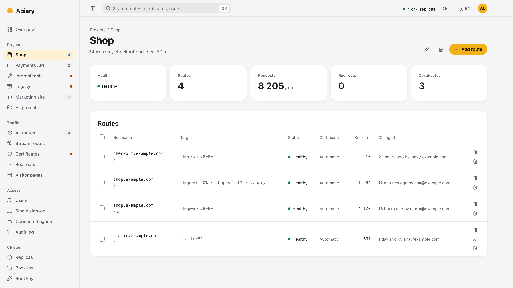

# Apiary

Apiary is a reverse proxy built for [Docker Swarm](https://docs.docker.com/engine/swarm/) clusters that must stay available. It routes incoming HTTP and HTTPS requests to Swarm services and manages TLS certificates automatically through [Let's Encrypt](https://letsencrypt.org/).



> **Status: beta.** Apiary is feature-complete: milestones 0 to 12 of the [implementation plan](docs/implementation-plan.md) are built: routing, sign-in and users, HTTPS with automatic certificates, replication across a Swarm, running a cluster safely (membership, backups, recovery and key rotation), everyday route features (redirects, disabling, allowlists and maintenance windows), projects with the overview, observability (target health, request rates, metrics and traces), AI agents over MCP with Apiary's own OAuth authorization server, releasing new versions (weighted targets, canaries, sticky sessions, compression and caching), single sign-on with OpenID Connect, and TCP and UDP stream routes with TLS passthrough. Since then: password-protected routes with sign-in links, and branded visitor pages. Decisions made along the way wait for review in [docs/review-notes.md](docs/review-notes.md), so some behavior can still change before `1.0.0`. From `1.0.0-beta.1`, each version reads the state of the one before it, so a beta can be upgraded in place.

## Goals

- **Built for Swarm.** Apiary is deployed as a Swarm service, reaches services by name over a Swarm overlay network, and replicates its own state between its replicas, with no external database or key-value store to run.
- **High availability.** Apiary runs as several replicas across nodes. Losing a replica or a node must not drop traffic or lose certificates, and no replica is a single point of failure.
- **Deployed with a stack file.** After creating one root key secret, deploying, upgrading and scaling Apiary (adding or removing replicas) is only `docker stack deploy` with a compose file, safe to do in production.
- **Runs small too.** The same image also runs on a one-node Swarm or with Docker Compose on a single computer, without high availability and with fewer features.
- **Automatic certificates.** Apiary obtains and renews certificates with the [ACME protocol](https://datatracker.ietf.org/doc/html/rfc8555) and shares them across all replicas, without manual steps.

## Try it

Apiary is in beta, so try it on your own machine or a development Swarm before relying on it. With Docker:

```bash
docker compose -f deploy/compose.yaml up --build
```

- `https://localhost:9443` is the admin UI, bound to your machine only. Its certificate is self-signed, so your browser warns about it: check that the SHA-256 fingerprint matches the one Apiary logs at start (`docker compose -f deploy/compose.yaml logs apiary`), then accept it. The first visit creates the first administrator, with an authenticator app. Administrators can upload a certificate your browsers trust on the Certificates page.
- Add a route from `whoami.localhost` to `whoami`, port 80, then open `http://whoami.localhost`.
- `docker compose -f deploy/compose.yaml logs -f apiary` shows the access log.
- Apiary generates a root key into the `keys` volume on first start, and warns about it. Without that key the `data` volume can't be read, so keep both, or mount your own key made with `docker run --rm apiary:dev secrets init` as a Compose secret at `/run/secrets/apiary_root_key`.

To try automatic certificates without a public address, add [Pebble](https://github.com/letsencrypt/pebble), Let's Encrypt's test server:

```bash
docker compose -f deploy/compose.yaml -f deploy/pebble/compose.yaml up --build
```

Add a route from `shop.apiary.test` to `whoami`, port 80. Pebble reaches Apiary through Docker's network, so it issues a certificate within seconds; see it under Certificates. Then check HTTPS with Pebble's root:

```bash
curl -sk https://localhost:15000/roots/0 > pebble-root.pem
curl --cacert pebble-root.pem --resolve shop.apiary.test:443:127.0.0.1 https://shop.apiary.test/
```

Without Pebble, Apiary asks Let's Encrypt's staging environment (`Apiary__Acme__DirectoryUrl`), which needs a public hostname pointing at your machine.

To issue automatic certificates, Apiary creates an account with the certificate authority and accepts its terms of service on behalf of whoever deploys it. For Let's Encrypt that's the [Subscriber Agreement](https://letsencrypt.org/repository/): by deploying Apiary with automatic certificates, you agree to it.

To try a cluster, use a Swarm. One node is enough to see replicas join, lose a leader and lose quorum; three nodes show it for real. On one node (`docker swarm init` first), with a root key and the image built locally:

```bash
docker build -t apiary:dev .
docker run --rm apiary:dev secrets init | docker secret create apiary_root_key_1 -
docker node update --label-add apiary.edge=true $(docker node ls -q)
APIARY_VERSION=dev docker stack deploy -c deploy/stack.yaml apiary
```

`deploy/stack.yaml` pulls `datapointsoftware/apiary`, so for a local image change its `image:` to `apiary:dev`. It runs one replica per node, so on one node only one starts; to see three, run them with `docker service create` instead, with a volume per replica (`type=volume,source=apiary-data-{{.Task.Slot}},target=/data`), as stack files can't template volume names. Then:

- Open Replicas in the admin UI to see the leader and the other replicas.
- Stop the leader's container (`docker kill`) and keep changing routes: one change waits 2 or 3 seconds for a new leader, and Swarm starts a new replica that joins by itself.
- Stop two of three replicas for a while (`docker pause` keeps Swarm from replacing them): the UI says "Changes are paused" and refuses changes, while routes keep working with the last configuration. Through Swarm's ingress ports, requests that land on a paused replica hang; that's the test, not Apiary.

For development without Docker, run `dotnet run --project src/Datapoint.Apiary` and, in `src/web`, `npm start`, which serves the UI on `http://localhost:4200`.

On macOS, use .NET runtime 10.0.14 or later (`dotnet --list-runtimes`). Even then, Kestrel may log `The encryption operation failed` with `Bad address` when a client drops a TLS connection; it's harmless and doesn't happen in the Linux containers.

## Documentation

- [Deploying](docs/deploying.md): step-by-step guide to set up Apiary on a production Swarm, for system administrators.
- [Releasing](docs/releasing.md): what CI checks, how to publish a version to Docker Hub, and how to try a pre-release on a development Swarm.
- [Architecture](docs/architecture.md): technology stack, deployment, routing, replicated state, certificates and management (admin UI and MCP).
- [Engineering](docs/engineering.md): repository layout, dependency rules between projects, and the .NET and Angular conventions.
- [Failure modes](docs/failure-modes.md): what happens when replicas, nodes or the network fail, and when the cluster is scaled.
- [Implementation plan](docs/implementation-plan.md): the order features are built in, and how to try each milestone.
- [Open decisions](docs/open-decisions.md): design questions still to be settled.
- [Review notes](docs/review-notes.md): decisions and findings from building the milestones, waiting for review.
- [Risks and considerations](docs/risks.md): security, privacy and operational risks. Read it before changing how Apiary stores state, handles secrets or is exposed to the network.

## Contributing

See [CONTRIBUTING.md](CONTRIBUTING.md) for how to propose a change, set up, test and open a pull request. Everyone taking part follows the [code of conduct](CODE_OF_CONDUCT.md). Report vulnerabilities privately, as the [security policy](SECURITY.md) explains.

[CLAUDE.md](CLAUDE.md) has the full conventions on branches, commits, merge requests and versions, and how AI agents work in this repository.

## License

Apiary is free software, licensed under the [GNU Affero General Public License, version 3](LICENSE) (AGPL-3.0), with additional terms in [NOTICE](NOTICE):

- You can use, change and share Apiary. If you share a modified version, or let others use it over a network, you must offer them its source code under the same license.
- The admin interface must keep the "Based on Apiary by Datapoint" attribution and the Datapoint logo.
- Modified versions must be marked as modified, and the license grants no rights to the Datapoint name or logo beyond that attribution. See the [trademark policy](TRADEMARKS.md).

Contributors sign the [Contributor License Agreement](CLA.md) before their first contribution is merged.

Copyright © 2026 Datapoint - Sistemas de Informação, Lda.
